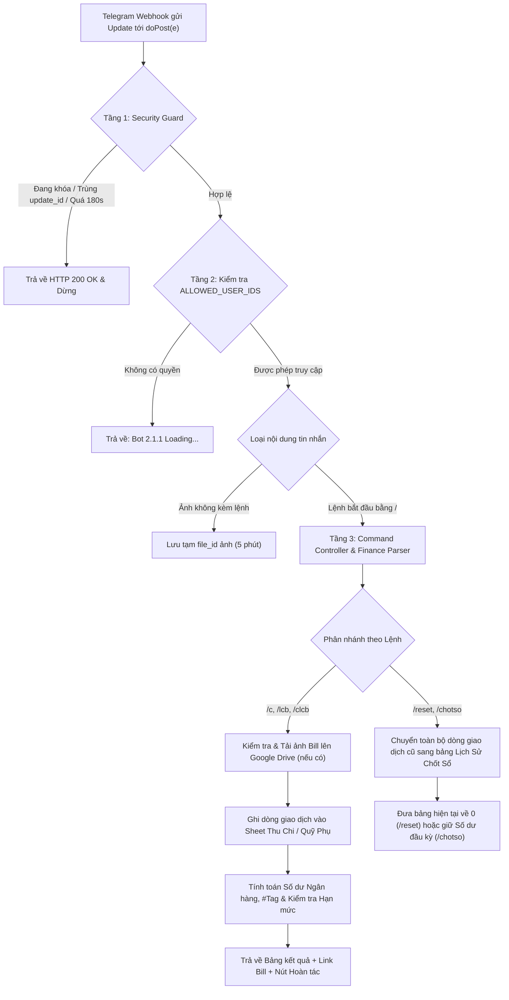

# Thiết kế Hệ thống & Cơ sở Dữ liệu (Phiên bản 2.1.1)

Tài liệu mô tả kiến trúc phân tầng theo nguyên lý SOLID, luồng xử lý giao dịch (Workflow) và cấu trúc 5 bảng dữ liệu trên Google Sheets của **Telegram GAS Finance Bot (v2.1.1)**.

---

## 1. Sơ đồ Luồng Xử lý (System Workflow)

<!-- ================================================================= -->
<!-- CHÈN ẢNH MINH HỌA SƠ ĐỒ KIẾN TRÚC (NẾU DÙNG ẢNH THAY MERMAID)     -->
<!-- Tên file ảnh gợi ý: ../images/07-so-do-kien-truc-he-thong.png     -->
<!-- ================================================================= -->

<!-- ================================================================= -->

---

## 2. Phân tách Trách nhiệm các Module (`src/`)

1. **`src/F1ActivateBot.js`**:
   - Nằm ở vị trí đầu tiên trên Google Apps Script Editor.
   - Chứa `ActivateBot()`, `setupEnvironment()` (nơi điền `WEBAPP_URL`, `TELEGRAM_BOT_TOKEN`, `ALLOWED_USER_IDS`) và `setWebhook()`.
2. **`src/GrantAllPermission.js`**:
   - Nằm ở vị trí số 2 trên Google Apps Script Editor.
   - Chứa `GrantAllPermissions()` gọi đồng thời 7 nhóm dịch vụ (`PropertiesService`, `CacheService`, `DriveApp`, `SpreadsheetApp`, `UrlFetchApp`, `ScriptApp`, `HtmlService`, `LanguageApp`) để xin cấp quyền 1 lần duy nhất.
3. **`src/main.js`**:
   - Điểm tiếp nhận `doGet(e)` và `doPost(e)`.
   - Hàm `finishResponse()` trả về `HtmlService.createHtmlOutput("OK")` trên môi trường GAS để ngăn lỗi `302 Found Redirect`.
4. **`src/core/config.js`**:
   - Quản lý biến cấu hình, hằng số `APP_VERSION = "2.1.1"`, danh sách `ALLOWED_USER_IDS` và hàm kiểm tra quyền `isAuthorizedUser(userId)`.
5. **`src/core/securityGuard.js`**:
   - Chứa `verifyWebhookSafety(updateData)`, `EmergencyStop()`, `ResumeBot()`.
6. **`src/core/financeParser.js`**:
   - Chứa `parseSingleMoneyTerm()`, `parseAmountExpression()`, `parseTransactionArgs()`, `parseLimitArgs()`, và hàm kẻ bảng `renderBoxTable()`.
7. **`src/services/telegramService.js`**:
   - Giao tiếp HTTP với Telegram API (`callTelegramApi`, `sendMessage`, `safeSendMessage`, `setTelegramWebhook`, `deleteTelegramWebhook`).
8. **`src/services/driveService.js`**:
   - Chứa `uploadBillPhotoFromMessage()`, `savePendingPhotoFromMessage()`, `resolveBillPhotoFileId()`, tự động lưu ảnh vào thư mục `SuperFinanceBot_Bills` trên Google Drive.
9. **`src/services/sheetService.js`**:
   - Tự động khởi tạo file Google Spreadsheet mới (`SuperFinanceGAS_Database_v2.1.1`) gắn với dự án GAS nếu chưa có.
   - Cung cấp các hàm đọc/ghi cho 5 bảng dữ liệu và hàm `archiveTransactionsToHistorySheet()` để lưu sổ liên thông.
10. **`src/services/financeService.js`**:
    - Xử lý toàn bộ nghiệp vụ tính toán số dư, hạn mức, hoàn tác, chốt sổ, reset và định dạng văn bản phản hồi.
11. **`src/controllers/commandController.js`**:
    - Điều phối toàn bộ các lệnh bắt đầu bằng `/` và các sự kiện nút bấm Inline (`handleCallbackQuery`).

---

## 3. Thiết kế Cơ sở Dữ liệu Google Sheets (5 Bảng)

File Google Spreadsheet được tự động khởi tạo gồm 5 trang tính (Tabs) chuẩn:

### 3.1. Bảng `Thu Chi` (Quỹ Cá Nhân - `/c`) và Bảng `Quỹ Phụ` (`/lcb`)
Gồm 9 cột:

| Cột | Tên Cột | Kiểu dữ liệu | Mô tả |
| :--- | :--- | :--- | :--- |
| **A** | `Mã GD` | Chuỗi | Mã định danh giao dịch duy nhất (ví dụ: `TX849201`). Với lệnh `/clcb`, cả 2 bảng dùng chung 1 `Mã GD`. |
| **B** | `Thời Gian` | Chuỗi | Thời điểm ghi nhận (`dd/MM/yyyy HH:mm:ss` theo múi giờ `Asia/Ho_Chi_Minh`). |
| **C** | `Người Nhập` | Chuỗi | Tên và Telegram User ID của người thực hiện lệnh. |
| **D** | `Ngân Hàng` | Chuỗi | Tên tài khoản ngân hàng hoặc nguồn tiền (`Techcombank`, `MB`, `CASH`, mặc định là `Chung`). |
| **E** | `Tag` | Chuỗi | Nhãn phân loại viết hoa (`#TRADA`, `#ANUONG`, mặc định là `#CHUNG`). |
| **F** | `Biểu Thức` | Chuỗi | Biểu thức gốc người dùng nhập vào (ví dụ: `'-35k-15k`). |
| **G** | `Số Tiền` | Số | Giá trị số nguyên đã quy đổi (dương là Thu, âm là Chi). |
| **H** | `Ghi Chú` | Chuỗi | Nội dung chi tiết của giao dịch. |
| **I** | `Link Ảnh Bill` | URL | Đường dẫn xem ảnh hóa đơn trên Google Drive (nếu có). |

### 3.2. Bảng `Hạn Mức` (`/limit`)
Gồm 4 cột:
`[ Tag | Hạn Mức | Cập Nhật Lúc | Người Đặt ]`

### 3.3. Bảng `Lịch Sử Chốt Sổ` (`/reset`, `/chotso`) — Sổ cái Liên thông
Gồm 11 cột, lưu nối tiếp toàn bộ từng dòng giao dịch của các kỳ/tháng trước đó:
`[ Kỳ Chốt / Reset | Nguồn Quỹ | Mã GD | Thời Gian GD | Người Nhập | Ngân Hàng | Tag | Biểu Thức | Số Tiền | Ghi Chú | Link Ảnh Bill ]`

Cuối mỗi đợt `/reset` hoặc `/chotso`, hệ thống tự động ghi thêm một dòng `TONG KET KY` để đánh dấu ranh giới giữa các kỳ mà vẫn cho phép lọc dữ liệu xuyên suốt nhiều tháng.

### 3.4. Bảng `Logs` (Nhật ký Hệ thống)
Gồm 4 cột:
`[ Thời Gian | Người Dùng | Lệnh / Sự Kiện | Kết Quả ]`
