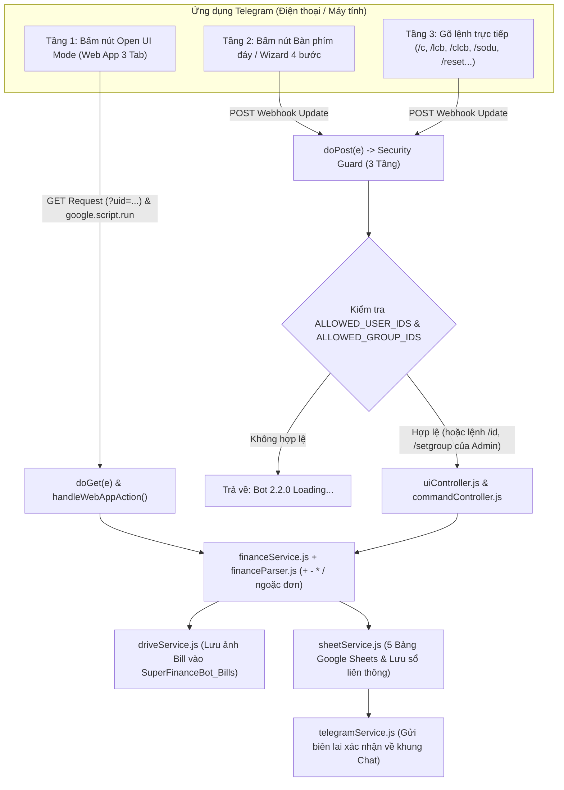

# Thiết kế Hệ thống & Cơ sở Dữ liệu (Phiên bản 2.2.0 - Hybrid UI)

Tài liệu mô tả kiến trúc phân tầng theo nguyên lý SOLID, luồng xử lý đa tầng (Web App UI + In-Chat Wizard + CLI Commands) và cấu trúc 5 bảng dữ liệu trên Google Sheets của **Telegram GAS Finance Bot (v2.2.0)**.

---

## 1. Sơ đồ Luồng Xử lý Hệ thống (System Workflow)

<!-- ================================================================= -->
<!-- CHÈN ẢNH MINH HỌA SƠ ĐỒ KIẾN TRÚC (NẾU DÙNG ẢNH THAY MERMAID)     -->
<!-- Tên file ảnh gợi ý: ../images/07-so-do-kien-truc-he-thong.png     -->
<!-- ================================================================= -->

<!-- ================================================================= -->

---

## 2. Phân tách Trách nhiệm các Module (`src/`)

1. **`src/F1ActivateBot.js`**:
   - Nằm ở vị trí đầu tiên trên Google Apps Script Editor.
   - Chứa hướng dẫn 3 bước thêm Bot vào Nhóm Telegram, cùng các hàm `ActivateBot()`, `setupEnvironment()` (nơi điền `WEBAPP_URL`, `TELEGRAM_BOT_TOKEN`, `ALLOWED_USER_IDS`, `ALLOWED_GROUP_IDS`) và `setWebhook()`.
2. **`src/GrantAllPermission.js`**:
   - Nằm ở vị trí số 2 trên Google Apps Script Editor.
   - Chứa `GrantAllPermissions()` gọi đồng thời 7 nhóm dịch vụ (`PropertiesService`, `CacheService`, `DriveApp`, `SpreadsheetApp`, `UrlFetchApp`, `ScriptApp`, `HtmlService`, `LanguageApp`) để xin cấp quyền 1 lần duy nhất.
3. **`src/main.js`**:
   - Điểm tiếp nhận `doGet(e)` (phục vụ giao diện đồ họa `uiWebApp.html` hoặc trả về trạng thái JSON khi truyền `?format=json`) và `doPost(e)` (tiếp nhận Telegram Webhook, kiểm tra `isAuthorizedInteraction(userId, chatId)` và cho phép lệnh `/id`, `/setgroup` của Admin đi qua để cấp quyền nhóm).
   - Hàm `finishResponse()` trả về `HtmlService.createHtmlOutput("OK")` để ngăn lỗi `302 Found Redirect`.
4. **`src/uiWebApp.html`**:
   - Giao diện đồ họa 3 Tab của chế độ **Open UI Mode** với máy tính đầy đủ phép toán (`+`, `-`, `*`, `/`, `( )`), thanh cuộn dọc tùy chỉnh và trình tải ảnh hóa đơn Base64.
5. **`src/core/config.js`**:
   - Quản lý biến cấu hình, hằng số `APP_VERSION = "2.2.0"`, danh sách `ALLOWED_USER_IDS`, `ALLOWED_GROUP_IDS` và các hàm kiểm tra/ghi đè quyền (`isAuthorizedUser`, `isAuthorizedGroup`, `isAuthorizedInteraction`, `setAllowedGroupIds`).
6. **`src/core/securityGuard.js`**:
   - Chứa `verifyWebhookSafety(updateData)`, `EmergencyStop()`, `ResumeBot()`.
7. **`src/core/financeParser.js`**:
   - Bộ phân tích đệ quy (Recursive Descent Parser) xử lý các biểu thức số học `+`, `-`, `*`, `/`, ngoặc đơn `( )`, đơn vị tiền tệ (`k`, `tr`, `1tr5`) và hàm kẻ khung bảng `renderBoxTable()`.
8. **`src/services/telegramService.js`**:
   - Giao tiếp HTTP với Telegram API (`callTelegramApi`, `sendMessage`, `safeSendMessage`, `editMessageText`, `setTelegramWebhook`).
9. **`src/services/driveService.js`**:
   - Chứa `uploadBillPhotoFromMessage()` (tải ảnh từ Telegram) và `uploadBase64BillToDrive()` (tải ảnh từ giao diện `Open UI Mode`) vào thư mục `SuperFinanceBot_Bills` trên Google Drive.
10. **`src/services/sheetService.js`**:
    - Tự động khởi tạo file Google Spreadsheet 5 bảng và thực thi lưu sổ liên thông qua `archiveTransactionsToHistorySheet()`.
11. **`src/services/financeService.js`**:
    - Xử lý toàn bộ nghiệp vụ tính toán số dư, hạn mức, hoàn tác, chốt sổ, reset và định dạng biên lai tối ưu màn hình hẹp (Z Fold).
12. **`src/controllers/uiController.js`**:
    - Quản lý bàn phím cố định 3 nút (`buildMainReplyKeyboard(userId, chatId)` tự động tương thích Group Chat khi `chatId < 0`), luồng chọn nút 4 bước trong chat (`sendWizardStep1..4`) và các hàm Backend API cho Web App (`getWebAppInitialData`, `handleWebAppAction`).
13. **`src/controllers/commandController.js`**:
    - Điều phối toàn bộ các lệnh bắt đầu bằng `/` (bao gồm `/id`, `/setgroup`), và các sự kiện nút bấm Inline (`handleCallbackQuery`, `handleGroupAuthCallback` cấp quyền nhóm 1 chạm).

---

## 3. Thiết kế Cơ sở Dữ liệu Google Sheets (5 Bảng)

1. **Bảng `Thu Chi` (Quỹ Cá Nhân - `/c`) và Bảng `Quỹ Phụ` (`/lcb`):**
   - 9 cột: `[ Mã GD | Thời Gian | Người Nhập | Ngân Hàng | Tag | Biểu Thức | Số Tiền | Ghi Chú | Link Ảnh Bill ]`
2. **Bảng `Hạn Mức` (`/limit`):**
   - 4 cột: `[ Tag | Hạn Mức | Cập Nhật Lúc | Người Đặt ]`
3. **Bảng `Lịch Sử Chốt Sổ` (`/reset`, `/chotso`) — Sổ cái Liên thông:**
   - 11 cột: `[ Kỳ Chốt / Reset | Nguồn Quỹ | Mã GD | Thời Gian GD | Người Nhập | Ngân Hàng | Tag | Biểu Thức | Số Tiền | Ghi Chú | Link Ảnh Bill ]`
4. **Bảng `Logs` (Nhật ký Hệ thống):**
   - 4 cột: `[ Thời Gian | Người Dùng | Lệnh / Sự Kiện | Kết Quả ]`
